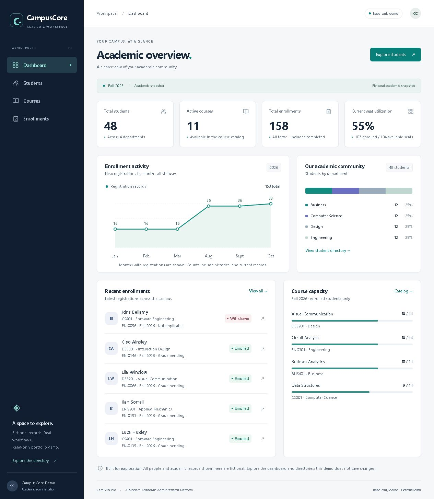

# CampusCore — Student Management System

A premium academic administration workspace built with ASP.NET Core MVC, .NET 10, Razor, Entity Framework Core 10, Bootstrap and custom CSS. Browse students, courses, enrollments and calculated dashboard charts in a fictional read-only demo, or manage records locally using SQL Server LocalDB.



## Features

- Student management: local create/edit/delete, department/year/status validation, unique identifiers and email, course-load details.
- Course management: local catalog CRUD, credits/capacity validation, active/archive rules and protected enrollment history.
- Enrollment and results: registration, withdrawal, completion and grade updates, duplicate prevention and transactional capacity checks.
- Calculated dashboard: student/course/enrollment totals, current seat utilization, registration trend, department distribution and course capacity.
- Browsing: searchable directories, sorting, combined filters, pagination, details and friendly empty states.
- Responsive navy/teal interface with semantic headings, labelled forms and keyboard navigation.

[View the student directory screenshot](docs/screenshots/students.jpg). Both screenshots are genuine captures of the local Production PublicDemo with fictional records, taken on 6 November 2026; no local SQL records or browser chrome are included.

## Stack and structure

.NET 10 / C# / ASP.NET Core MVC and Razor; EF Core 10 SQL Server provider; SQL Server 2025 LocalDB; Bootstrap 5.3.3, custom CSS, vanilla JavaScript and SVG charts. Controllers compose views, query services supply academic snapshots, and the write service enforces business rules. Data contains EF configuration, reviewed migrations and development seed logic.

## Two explicit modes

| Mode | Data | Writes | Environment |
| --- | --- | --- | --- |
| PublicDemo | Fixed fictional fixture; fresh per request | Always rejected server-side | Production recommended |
| LocalSql | SQL Server 2025 LocalDB | Validated, antiforgery-protected local CRUD | Development only |

PublicDemo registers neither a database context nor a write service and never reads a connection string. All unsafe HTTP methods are blocked even if the write flag is enabled. LocalSql restricts reads and writes to loopback host/local/remote addresses and rejects proxy headers and foreign Origin requests. There is no authentication; LocalSql is a trusted single-user workstation feature, not a public administration service.

## Requirements

Verified on Windows with .NET SDK 10.0.403, ASP.NET Core runtime 10.0.14 and EF Core 10.0.14. SDK selection is pinned in global.json. Only LocalSql requires SQL Server 2025 Express LocalDB (verified 17.0.1000.7). PublicDemo needs no SQL installation or connection string. No frontend package build is required. PowerShell 7 runs the HTTP verification scripts.

## Run the public demo safely

From the project directory (replace the path with your clone location):

```powershell
dotnet restore
dotnet build -c Release
$env:DOTNET_ENVIRONMENT = "Production"
$env:ASPNETCORE_ENVIRONMENT = "Production"
$env:CampusCore__Mode = "PublicDemo"
$env:Development__EnableWrites = "false"
Remove-Item Env:ConnectionStrings__CampusCore -ErrorAction SilentlyContinue
dotnet run -c Release --no-build --no-launch-profile -- --urls http://localhost:5094
```

Open http://localhost:5094. Stop with Ctrl+C. Root configuration already defaults to PublicDemo; explicit settings make deployment intent clear. Unknown/missing mode and Production LocalSql fail startup. Do not start duplicate servers on the same port.

## Local database workspace

First restore and Release-build as shown above. Use an existing approved development database, or explicitly review/apply migrations and seed a new empty development database:

```powershell
$env:DOTNET_ENVIRONMENT = "Development"
$env:ASPNETCORE_ENVIRONMENT = "Development"
$env:CampusCore__Mode = "LocalSql"
$env:Development__EnableWrites = "true"
dotnet tool restore
dotnet run -c Release --no-build --no-launch-profile -- --migrate-dev
dotnet run -c Release --no-build --no-launch-profile -- --seed-dev
dotnet run -c Release --no-build --no-launch-profile -- --urls http://localhost:5080
```

Development configuration uses `Server=(localdb)\MSSQLLocalDB;Database=CampusCoreDevelopment;Integrated Security=true;Encrypt=false`. This is non-secret Windows integrated local configuration, not a hosted connection. No passwords are stored. Database files are outside the repository in LocalDB's user profile storage. Migrations and seed never run on web startup. Seed skips if any academic records exist. Never reset an existing database or apply destructive migrations to obtain sample data.

Student/course identifiers and email have unique indexes. Enrollment has restricted foreign keys, a unique student/course/term/year index and grade/status constraints. Rowversions prevent stale edits; serializable writes with an application lock enforce capacity. Completed history is retained. Form models and server validation constrain writes.

## Publish and host PublicDemo

```powershell
dotnet publish -c Release --self-contained false -o ./artifacts/publish
# Set the Production/PublicDemo environment above, then:
Set-Location ./artifacts/publish
dotnet ./CampusCore.dll --urls http://localhost:5094
```

Publish the complete output, including runtime/dependency files, configuration and physical wwwroot. UseStaticFiles runs before routing; do not copy only the DLL. Start from the output directory or supply its content root. The output may contain non-secret Development settings; never set the hosted environment to Development. IIS uses the generated web.config and requires an appropriate hosting bundle. A framework-dependent Linux/Windows host requires a supported ASP.NET Core 10 runtime; SDK is needed on the build machine only. A Linux/container package must be built and tested for that target before release; the Windows local publish does not prove Linux compatibility.

Non-secret deployment settings:

| Setting | Value / purpose |
| --- | --- |
| DOTNET_ENVIRONMENT | Production |
| ASPNETCORE_ENVIRONMENT | Production |
| CampusCore__Mode | PublicDemo |
| Development__EnableWrites | false (defense in depth; demo ignores enabled writes) |
| AllowedHosts | Actual approved hostnames, separated by semicolons; replace root wildcard |
| ASPNETCORE_URLS | Host-provided bind address/port, e.g. http://0.0.0.0:8080 in an isolated container; use localhost for local review |

The mode/environment must resolve correctly; the write flag already defaults false. No SQL configuration, DATABASE_URL, migrations or seed is required for hosting. DATABASE_URL is not an application setting. Academic__CurrentTerm and Academic__CurrentYear affect LocalSql queries only; PublicDemo uses its fixed Fall 2026 fixture.

The app currently does not call UseHttpsRedirection, UseHsts or explicitly configure ForwardedHeaders middleware. A hosting plan must enforce HTTPS/HSTS at its edge, prevent direct untrusted backend access, validate Host and test proxy behavior. If application-side scheme/IP forwarding is needed, configure only trusted proxies before dependent middleware. Do not blindly trust client-supplied forwarding headers. This is a Phase 4C deployment prerequisite, not verified by local HTTP tests.

A free container-capable host is realistic for a low-traffic fictional portfolio demo. Render is one candidate, not a selected service: Docker support can run ASP.NET Core, while free instances sleep, have quotas and ephemeral storage. No Dockerfile/container deployment has been prepared or tested. GitHub Pages cannot execute this server-side MVC application.

References: [Microsoft proxy guidance](https://learn.microsoft.com/en-us/aspnet/core/host-and-deploy/proxy-load-balancer?view=aspnetcore-10.0), [.NET support policy](https://dotnet.microsoft.com/en-us/platform/support/policy), [Render Docker](https://render.com/docs/docker), [Render free limitations](https://render.com/docs/free).

## Verification

Phase 4A: Release build/publish, dependency audit, 164 demo HTTP assertions and 248 linked URLs, 21 browser page/viewport combinations, 8 fail-closed configuration cases, 7 demo isolation plus 22 fixture checks, 53 SQL/security plus 22 query checks, and HTTP CRUD 26 setup / 4 restart / 6 cleanup checks passed. See [QA.md](QA.md) and [AUDIT.md](AUDIT.md) for evidence and limitations. Full accessibility compliance, external penetration testing and live hosted behavior are not claimed.

Useful commands (set the appropriate mode first):

```powershell
dotnet list package --vulnerable --include-transitive
dotnet run -c Release --no-build --no-launch-profile -- --verify-demo
pwsh ./scripts/verify-demo.ps1 -Base http://localhost:5094
pwsh ./scripts/verify-configuration.ps1
# LocalSql only; creates and removes its own disposable verification database:
dotnet run -c Release --no-build --no-launch-profile -- --verify-database
```

HTTP CRUD setup/cleanup scripts require a disposable seeded LocalSql fixture. Do not run them against a database containing user records. Several QA scripts currently assume Windows SDK paths and fixed fixture totals; portability is future work.

## Live demo

**Not yet deployed.** PublicDemo runs locally using the commands above. Public hosting requires the Phase 4C runtime, HTTPS, proxy and security checks; there is no live demo URL yet.

## Known limitations

LocalSql is a trusted local workstation workspace, not a multi-user authenticated service. Queries load snapshots suitable for this small dataset; large-scale paging is future work. Browser/accessibility checks are targeted, not full WCAG certification. No external penetration test or Linux/container/IIS production execution has been performed. QA scripts use Windows SDK paths and fixed fixture totals. NuGet vulnerability checks do not certify all vendored frontend assets.

## License

Licensed under the [MIT License](LICENSE). Third-party rights remain with their owners; Bootstrap's bundled license is retained at wwwroot/lib/bootstrap/LICENSE. No hosted deployment or automated CI claim is made.
